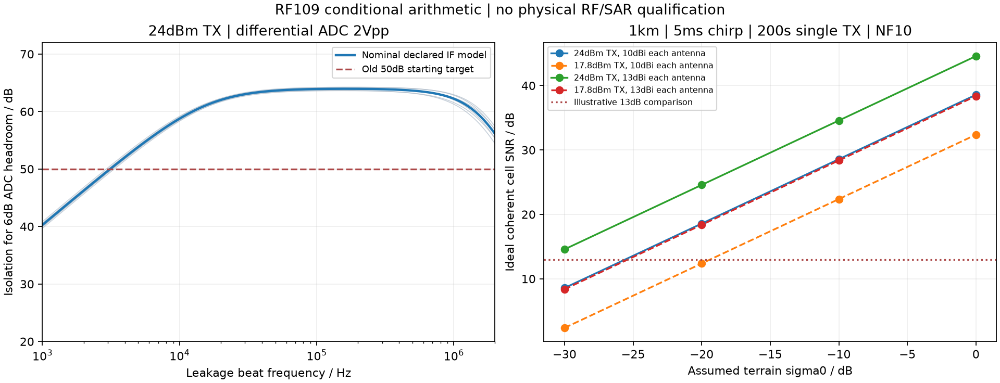

# RF109 射频稳定性、链路预算与阻抗匹配专项核查

2026-11-17。硬件仍为RF109，配套参考RTL088/FW100。本次只核查并更新说明，没有修改原理图、PCB、受控BOM或制造文件；“114”只是本地审查批次，不是硬件RF版本。

## 结论

PLL局部小信号模型和TRF37A73参考S参数具备稳定性裕量；整板射频稳定性和匹配尚未完成签核。当前应优先闭合LO低输出余量、接收动态范围、PA连续热负荷，以及与工厂叠层绑定的真实电磁模型。没有证据要求直接重布全部射频线，也不能将已有无源HFSS低反射结果当作整板功能合格。

| 项目 | 本次结果 | 适用范围与剩余问题 |
|---|---|---|
| PLL小信号环路 | 18个角点最小相位裕量68.49°、增益裕量26.79dB；交越70.75–222.23kHz | TI TLV172宏模型+真实R/C，VCO和电荷泵为声明的线性化；未覆盖全PVT、周期PFD/DSM、相噪、启动或实板 |
| TRF37A73 | 5.0–5.5GHz参考数据K≥1.4379、µ≥1.6545 | TI参考S2P未注明偏置/温度；实际偏置、PCB及其他PA/LNA未全部闭合 |
| 发射/LO | 名义PA约23.95–24.95dBm；较低输出/增益组合约17.95–18.95dBm | 组合表条件，不是整板保底；低端LO约−8.82dBm，距−10dBm功能下限仅1.18dB |
| 接收动态范围 | 指定0.614MHz模型下，24dBm TX/50dB总隔离可产生4.70Vpp差分，超过ADC 2Vpp满量程 | 该频点留6dB余量约需63.43dB总隔离；近DC泄漏受高通抑制，不能泛化所有直接泄漏 |
| PA热负荷 | 厂家24dBm测试条件下耗散约2.75W典型、3.12W上界组合 | WLAN测试条件不是CW保证；9个热PTH不能证明板到环境热阻足够 |
| 匹配 | 0.17mm主线单微带规划约51.22Ω；历史局部模型S11最差−21.10dB | CPWG/地窗/过渡需要场解；历史Z-only模型叠层不同，不能给当前RF109签核 |

## 稳定性

PLL从当前RF109网表核对R4=1k、R5=4.7k、R6=5.1k、C10=6.8nF、C14=68pF、R7=0、C29=DNP。使用相同TI TLV172原厂宏模型，分别在5.02/5.25/5.48GHz、−40/25/85℃及两组声明元件/偏置敏感性角点进行ngspice46 AC分析，共18组、每组961点、1Hz–100MHz。

环路定义L(s)=Icp·Kvco(Hz/V)·Ztune(s)/(s·N)，N=fRF/20MHz。以固定CP直流偏置的AC电压源求取Ztune=V(tune)/[−I(VBIAS)]，包含实际滤波器和运放输入。每组检查直流工作点及低频非反相闭环增益；初始偏置夹具的无效工作点结果已丢弃，不作结论。独立从原始结果重算相位裕量，差异小于3×10^-14°，并检查奇数180°交越。FW100的R3.DB6=1与正Kv负反馈极性一致。

最小PM68.4904°、GM26.7936dB支持这些局部线性化条件下的稳定性；工程筛选目标PM45°。VCO斜率来自典型调谐曲线图读值，±10%等属于敏感性假设，不是厂家保证的批次角点。原200µs回扫保护的36组非线性平均模型仍沿用原范围，不能因此承诺硬件PLL锁定、扫频线性、杂散或相噪。

重新下载TI SLAM237的TRF37A73 S2P，与此前真实ADS所用数据逐字节相同。5.0–5.5GHz的100个原生点及两个区间内插值端点：K≥1.4379、µ≥1.6545、µ′≥1.6544、|Δ|≤0.3674。参考网络在VSWR2相位负载组合中的转换增益约8.85–11.73dB，VSWR3约6.69–11.33dB；这不是PCB负载牵引或大信号资格。SKY65404和TQP5525尚无完整可用的真实偏置/PVT复杂模型；无源HFSS或LO ADS不能替代主动链自激分析。

TQP5525在5V、25℃无RF时仍约350mA典型/400mA上界，24dBm表条件为600/675mA。由5V×I−Pout得约2.75/3.12W耗散；5.25V保守组合约3.29W。θjc=17℃/W是结到封装背面，不能当板到环境热阻。若以封装地85℃作条件界限，25℃环境下约需焊盘到环境≤18.22℃/W，50℃环境≤10.63℃/W。实际CW电流、焊接空洞、铜散热和温升仍需验证。continuous_pa模式使“只按chirp占空比折算热量”不成立。

U442的VCCB与PA VCC1共用R302=27Ω后的节点，100Ω输出串阻/1k下拉可额外造成约0.126V的条件静态压降；这不是已证明欠压，但首板需测VCC1、PA_EN和开启瞬态。名义PA输入约−7.05dBm；若套上频段37dB最大小信号增益，线性预测已约29.95dBm，接近30dBm最小P1dB，典型24–25dBm并不保证所有角点留有5dB线性余量。

## 链路预算和动态范围

当前路径：HMC430→16.9Ω星形分路（理想6.05095dB）→3dB垫片U12→TQP5525→定向耦合器；耦合端→6dB垫片U3→巴伦→ADL5802 LO。两路RX为SKY65404→TRF37A73→巴伦→混频器。

HMC430表条件输出为−1dBm最小/+2dBm典型。TQP5525 5.0–5.15GHz增益28/31/35dB，5.15–5.5GHz为29/32/37dB（min/typ/max）。组合最小值未包含整板PVT和走线损耗；24dBm公里预算因此仅是名义假设。结合现有无源LO网络，低端LO约−8.82dBm，仅比混频器−10dBm功能下限高1.18dB，低LO下的转换增益/噪声不能照搬0dBm驱动表格。

未采用提案：U3由6dB改为同系列3dB。理想匹配下低端LO可升至约−5.82dBm；PA30dBm时LO约+6.23至+7.93dBm，距+10dBm上限最少2.07dB，仍需实际S参数、负载及PVT验证。未修改BOM或用理想3dB平移当作换料验收。

106接收模型中的75个唯一元件已逐项与RF109核对值和引脚网络一致。0.614MHz典型电压增益43.43dB，天线端单音约−33.43dBm会达到ADC 2Vpp差分满量程。24dBm发射/50dB总隔离意味着−26dBm泄漏；若落在该频点，约4.70Vpp，超量程7.43dB。只避免夹顶约需57.43dB隔离，留6dB余量约需63.43dB。这里的隔离包括天线、结构、线缆、板内泄漏等总路径，不能仅看天线指标。近DC直接泄漏和延迟多径要分别用其频点评估。近/远软件模式主要切采样/FIR，TRF PWDN固定接地，不是模拟增益档位切换。

1km慢速SAR条件算例：5ms扫460MHz、1ms间隔、200s、单TX约33333次chirp、NF10dB、其他损耗3dB、假定sigma0=−20dB。各端10dBi天线且理想相干/Hann积累时，24dBm方案SNR约18.57dB；以17.8dBm低功率规划则约12.37dB。各端13dBi可再加6dB，但天线尚未实测。旧未来双TX交替口径每极化16666次，比当前单TX少3.01dB积累增益；当前没有因此新增四极化功能。

NF10只适合慢chirp的规划参考；1.534MHz低增益情景已有约10.01–13.16dB，不能视为全模式上限。上述SNR未包含实际泄漏相噪、PA附加噪声、杂波、运动/自聚焦与跨记录相干误差。仅作100kHz偏移示例：−26dBm泄漏与−103dBc/Hz相噪相乘，未经同源抵消为−129dBm/Hz，高于NF10等效输入热噪声约35dB；理想同源延迟抵消又取决于4sin²(πfτ)，不能把单一偏移数值外推整带。

## 阻抗匹配与旧HFSS的适用性

RF109原生介厚依次0.1107/0.1016/0.9256/0.1016/0.1107mm，外铜0.0432mm、内铜0.0175mm，Dk4.5、tanδ0.02、双面阻焊各0.01mm，名义总厚1.5266mm。工厂压合和高频材料值尚未冻结。

沿用的23点HFSS来自JLC3313 Z-only敏感性模型：介厚0.0994/0.55/0.1088/0.55/0.0994mm，铜厚及Dk也不同。耦合器下方参考L3的距离从当前约0.2298mm变为模型约0.6646mm。重新提取同一11×6.2mm区域，8端口与50孔一致，但L6有2.7900mm²铜形差异。旧模型不是当前RF109完整几何及工厂板层的匹配证明。

独立联立厂家耦合器与局部网络原始S参数，在5.0–5.5GHz 11点重算：历史Z-only模型S11最差−21.10dB，TX插损0.262–0.283dB，方向性25.95–29.87dB。旧原生叠层5.2–5.5GHz方向性仅19.52–19.82dB；不能只凭S11较低忽略叠层对方向性的影响。旧Pass16的全局/弱耦合数值收敛成立，但5.0–5.15GHz是在固定网格上另求解。

0.17mm线宽按有限铜厚单微带规划约51.22Ω；选定工艺敏感性例子约44.44–58.90Ω。这不是含侧地、阻焊、频散与过渡的CPWG场解，无证据应立即改线宽。31.541mm整条LO含L1/L6和两个0.26mm信号PTH，旧短区域没有覆盖它、真实SMA或接收LNA接口。

Johanson巴伦明确为50Ω非平衡、50Ω差分，平衡测量每腿25Ω。旧ADS的端口定义正确，实际差分走线与ADL5802复阻抗仍需建模。铜段长度差约0.316–0.396mm，只能粗估为数度相位误差，不能盲目按长度加蛇形。

## 下一步优先顺序

1. 锁定工厂高频叠层/截面，再对当前RF109的PA/耦合器/TX SMA、完整LO换层、两路RX及巴伦差分接口分别做HFSS；统一厂家S参数参考面，检查去嵌/重复夹具、混模端口与弱耦合收敛。
2. 对U3 3dB提案做真实负载与电平上下限复核；以实际IF传递函数评估强回波/多径动态范围，必要时再设计可校准模拟衰减/增益档位。不能靠提高数字采样率解决模拟夹顶。
3. PA散热/供电与连续工作试验：封装温度、5V总电流、VCC1/PA_EN、DET对输出功率校准、温度和失配负载下功率/杂散。先限流、负载/衰减器和热监测，再上实际天线。
4. VNA/TDR与实板PLL/收发测量后校准链路预算、LO、NF和相干成像参数。

本次新增ngspice PLL AC、官方TRF S参数复算、链路算术、历史HFSS数据与原生几何复核；未重跑整板HFSS/ADS、DRC/ERC、通用EMC/热/生命周期分析。范围为射频专项，不是新一次全板制造签核。所有CAD/BOM与制造放行状态保持不变，原始日志、模型数据库和调试脚本仅留本地。

## 原厂与方法来源

- [ADI HMC430](https://www.analog.com/media/en/technical-documentation/data-sheets/hmc430.pdf)，第1–2页输出/调谐条件。
- [Qorvo TQP5525](https://www.qorvo.com/products/p/TQP5525)，原厂数据表第2–3页增益、功率、电流、热及VSWR条件。
- [TI TRF37A73](https://www.ti.com/lit/ds/symlink/trf37a73.pdf)及[SLAM237 S参数](https://www.ti.com/lit/zip/slam237)。
- [TI TLV172](https://www.ti.com/product/TLV172)，原厂宏模型；[ADI ADF4158](https://www.analog.com/media/en/technical-documentation/data-sheets/adf4158.pdf)极性/电荷泵规定。
- [ADI ADL5802](https://www.analog.com/media/en/technical-documentation/data-sheets/adl5802.pdf)，LO/IF表条件。
- [Johanson 5400BL15B0050001E](https://www.johansontechnology.com/docs/4569/Balun-5400BL15B0050001E.pdf)，50Ω差分定义。
- [TTM X4C60K1-20S](https://cdn.ttm.com/repository/products/wireless-xinger/10-20-30-dB-directional-couplers/X4C60K1-20S/X4C60K1-20S.pdf)，耦合器与测试板。
- [Hammerstad–Jensen公式说明](https://qucs.sourceforge.net/tech/node75.html)，准静态规划，非本板HFSS结果。
